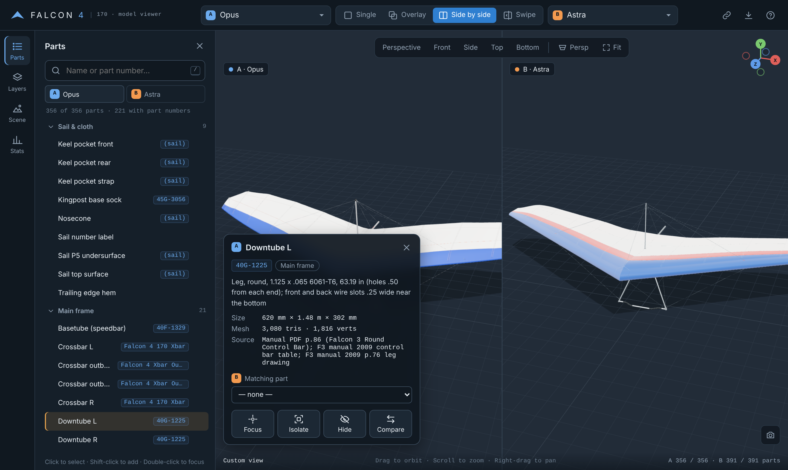
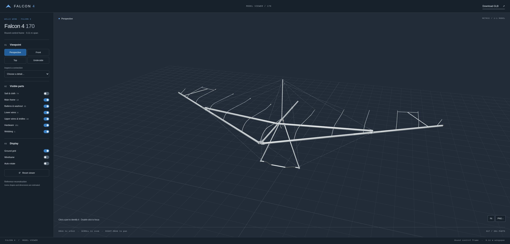
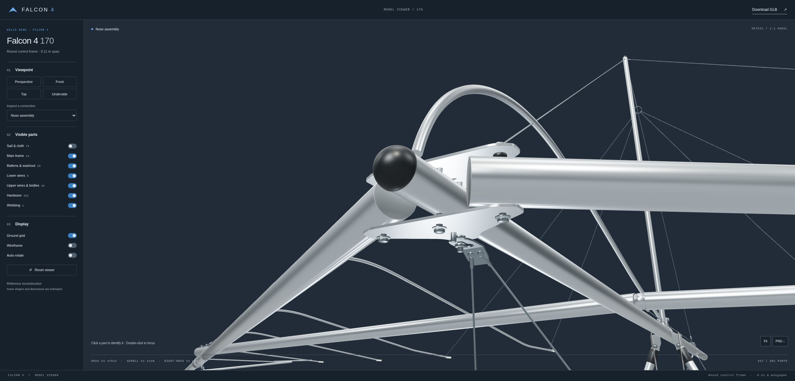

# Falcon 4

Blender models of the **Wills Wing Falcon 4 170** and an interactive Three.js
viewer that switches between two independent reconstructions.



| Build | Parts | What it is |
|---|---|---|
| **Astra** | 669 | Round control frame, blue/red/off-white sail, resting ground configuration |
| **Opus** | 356 | Hardware matched to the owner's manual with part numbers (nose plate, keyhole tangs, crossbar junction, speedbar corners), batten strings and lever tips, reflex bridles, washout tubes |

Both builds use the same seven visibility groups. Some shapes and dimensions are
approximate. Don't use either model as a maintenance reference; use the Wills
Wing manual.

## Run the viewer

The viewer is published at **https://janderssn.github.io/falcon4/** on every push to `master`
(see [`.github/workflows/pages.yml`](.github/workflows/pages.yml)).

To run it locally:

Requires Node.js 22.12+ and a WebGL-capable browser. The models are included, so
you don't need Blender to run the viewer.

```sh
git clone https://github.com/janderssn/falcon4.git
cd falcon4
npm ci
npm run dev
```

Open **http://localhost:5180**. Add `?model=opus` or `?model=astra` to the URL to open a specific build.

The viewer is a glider configurator:

- **Compare** (top of the view buttons, `V`): shows the other build to the right of
  a divider you can drag, in the same pose and colours.
- **Settings** (gear, top right corner, `S`): pick the build (Astra or Opus), the colour
  profile (the Wills Wing colour picker's colours, or calibrated to the real cloth where
  measured: Blue 7304, Red 3125, White 170), turn the floor grid in the studio on or off,
  turn the shadows on or off, and turn film blur on or off: clear laminates show what is
  just behind them sharp and blur what is further away (off on phones by default).
- **Sail cloth:** each panel's material follows its fabric, matched to photos of the real
  cloth. Woven polyester (Dacron) is opaque with a plain resin finish; the MT cloths add a
  diamond ripstop of paired threads; the laminates are glossy film over an opaque scrim and
  X-ply (black in the "B" cloths), and the hazy film shows what is behind it. The studio light is Poly Haven's "Studio Small 09" HDRI (CC0).
- **Customize** (top right, `C`): colour the sail
  panels as in the Wills Wing Falcon colour picker - P1 leading edge, P2 forward, P3 middle,
  P4 trailing edge, P5 undersurface - with the Wills Wing fabric list for each
  panel (the clear and tinted laminates are see-through), plus the batten pockets;
  choose the frame finish; make the sail see-through to look at the frame; show or
  hide the wires and bridles, and the battens (the batten strings hide with the
  sail or the battens); label where each colour row goes on the glider, with the
  colour chosen in it. Each part is one line with its colour and fabric (and any extra
  cost); click a line to choose. *As built* (the first swatch in each list) restores the
  original colour. **Order form** lays the glider out as a printed order request with
  part numbers and the known prices. Colours are approximate and for
  show only; Wills Wing's own picker notes the same.
- **Pose** (bottom of the view): tail down, standing on the control bar, or nose
  down - resting on the keel, rocked over the basebar until the tail or the nose
  touches the ground, with the angle found from each model.
- **Scene** (bottom left): studio, hangar, or a hill with grass in the wind,
  where you can also set the time of day and the wind. The camera stays above the
  ground on the hill and inside the hangar; in the studio you can look up from below.
- **View** (bottom right): fly around (`F`), back to the start view (`N`), plan view
  from above (`T`), zoom. Drag to turn, right-drag to move, scroll to zoom.
- **Numpad** as in Blender: `1` front, `3` right, `7` top (with `Ctrl`: back, left,
  bottom), `9` the opposite side, `5` 2D/3D, `0` the start view, `2` `4` `6` `8` turn
  15°, `.` the selected part, `+` `-` zoom. The number row keeps switching scenes.
- Click a sail panel, the pockets or the frame (or its label) to open Customize with only
  that part's choices; **All parts** shows the rest.
- **Copy link to this glider** puts the whole configuration in the link: build,
  colours, scene, settings, time of day and camera.
- The viewer opens on the Opus build, magenta with Medium Blue P3 and P4, a graphite
  frame, resting tail down, seen from below the wing
  (`DEFAULTS` in [`viewer/main.js`](viewer/main.js)). **Reset** returns to these
  colours; *As built* in a row gives the build's original colour (`built` in the link).

```sh
npm run build     # Static site in viewer/dist/
npm run preview   # Preview at http://localhost:5181
```

## Model files

| | Astra | Opus |
|---|---|---|
| Blender | [models/astra/falcon4_170_astra.blend](models/astra/falcon4_170_astra.blend) | [models/opus/falcon4_170_opus.blend](models/opus/falcon4_170_opus.blend) |
| GLB (viewer) | [viewer/public/models/astra/model.glb](viewer/public/models/astra/model.glb) | [viewer/public/models/opus/model.glb](viewer/public/models/opus/model.glb) |
| Part groups | [parts.json](viewer/public/models/astra/parts.json) | [parts.json](viewer/public/models/opus/parts.json), generated by `node tools/make_opus_parts.cjs` |

[`viewer/public/models.json`](viewer/public/models.json) lists the builds. Each
entry gives the GLB, the parts file, and an optional `rotateY` / `offset`. The
opus model is turned 180° so its nose points the same way as astra's. The viewer then
puts every build on the same floor: the point where the basebar touches the ground is
at y = 0, whatever the file's own origin, so the builds don't jump when you switch or
compare them. (The model repos have issues open to export in one shared frame, so this
correction and `rotateY` can go: janderssn/falcon4-astra#3, janderssn/falcon4-opus#11.)
To add another build, add an entry there.

- `version` is added to the GLB and parts URLs (`?v=…`). Change it whenever you
  replace a model file, so browsers load the new file at once and don't use a
  cached copy.

The sail colour and frame finish choices find their parts by part or material name
(`ZONES` in [`viewer/main.js`](viewer/main.js)). The fabric names and screen colours in
[`viewer/lib/fabrics.js`](viewer/lib/fabrics.js) come from the Wills Wing colour picker
data (model type "Falcon"). The opus sail has its colours baked
into textures; the viewer keeps the texture's light and dark (seams, stitching) and
swaps the hue. The scene and glider-card pictures in `viewer/public/thumbs/` are
rendered from the viewer itself by `node tools/thumbs.mjs` (Playwright and Pillow;
start `npm run dev` first).

This repository contains the models, viewer and screenshots. The reconstruction
scripts, research documents and reference photographs are kept in separate
private repositories.

## Screenshots

### Airframe and rigging



### Nose assembly


