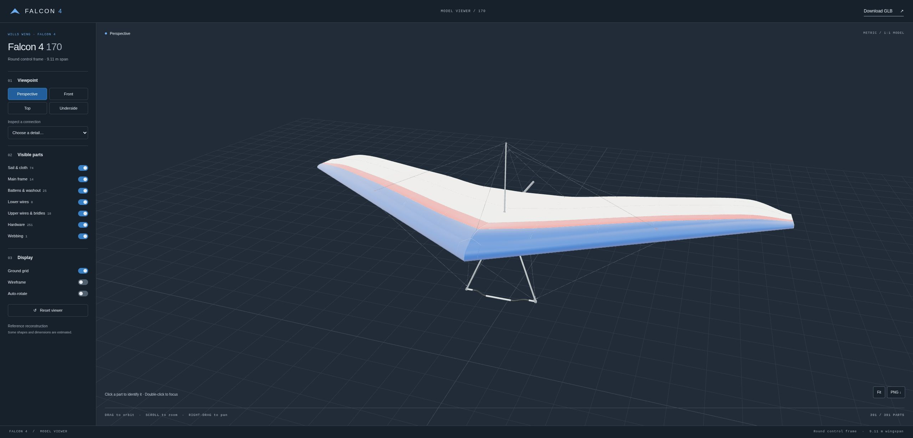
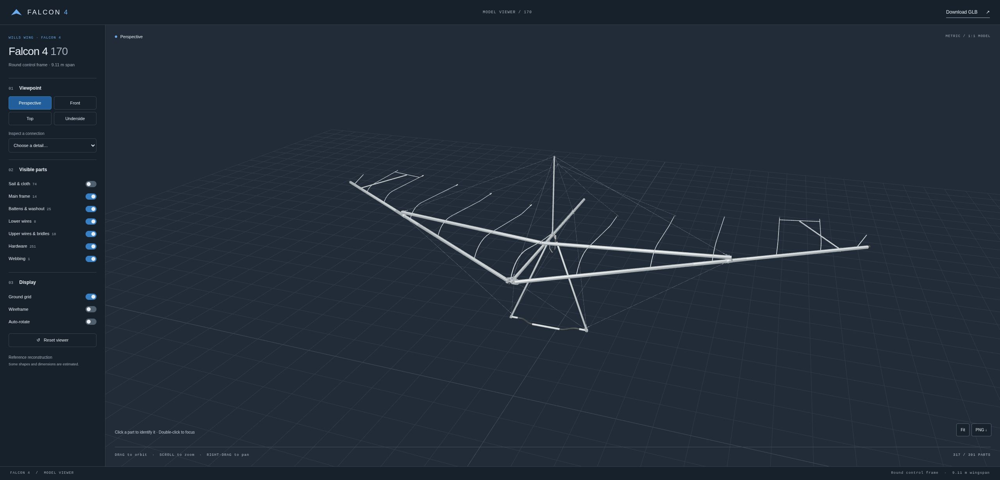
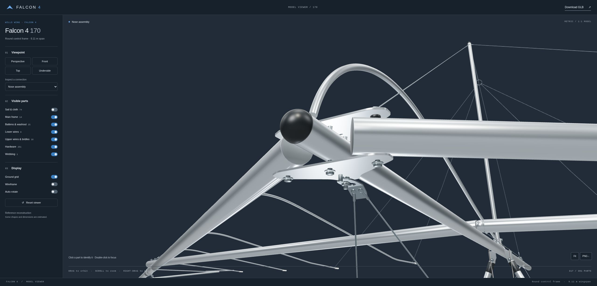

# Falcon 4

Blender models of the **Wills Wing Falcon 4 170** and an interactive Three.js
viewer that switches between two independent reconstructions.



| Build | Parts | What it is |
|---|---|---|
| **Astra** | 391 | Round control frame, blue/red/off-white sail, resting ground configuration |
| **Opus** | 317 | Hardware matched to the owner's manual with part numbers (nose plate, keyhole tangs, crossbar junction, speedbar corners), batten strings and lever tips, reflex bridles, washout tubes |

Both builds use the same seven visibility groups. Some shapes and dimensions are
approximate. Don't use either model as a maintenance reference; use the Wills
Wing manual.

## Run the viewer

Requires Node.js 22.12+ and a WebGL-capable browser. The models are included, so
you don't need Blender to run the viewer.

```sh
git clone https://github.com/janderssn/falcon4.git
cd falcon4
npm ci
npm run dev
```

Open **http://localhost:5180**. Add `?model=opus` or `?model=astra` to the URL to open a specific build.

- Pick a build with **Model** in the sidebar.
- Drag to orbit, right-drag to pan, and scroll to zoom.
- Click a part to identify it; double-click to focus.
- Switch viewpoints and inspect connections from the sidebar.
- Toggle sail, frame, battens, wires, hardware and webbing separately.
- Save a viewport PNG, or download the current build's GLB.

```sh
npm run build     # Static site in viewer/dist/
npm run preview   # Preview at http://localhost:5181
```

## Model files

| | Astra | Opus |
|---|---|---|
| Blender | [models/astra/falcon4_170_astra.blend](models/astra/falcon4_170_astra.blend) | [models/opus/falcon4_170_opus.blend](models/opus/falcon4_170_opus.blend) |
| GLB (viewer) | [viewer/public/models/astra/model.glb](viewer/public/models/astra/model.glb) | [viewer/public/models/opus/model.glb](viewer/public/models/opus/model.glb) |
| Part groups | [parts.json](viewer/public/models/astra/parts.json) | [parts.json](viewer/public/models/opus/parts.json), generated by `node tools/make_opus_parts.cjs` |

[`viewer/public/models.json`](viewer/public/models.json) lists the builds. Each
entry gives the GLB, the parts file, and an optional `rotateY` / `offset`. The
opus model is rotated 180° and raised to stand on the same ground plane as astra.
To add another build, add an entry there.

This repository contains the models, viewer and screenshots. The reconstruction
scripts, research documents and reference photographs are kept in separate
private repositories.

## Screenshots

### Airframe and rigging



### Nose assembly


